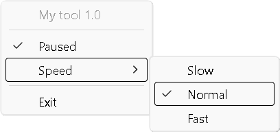

# wintray

A small C library that puts an icon in the Windows notification area (the
tray next to the clock), with a tooltip and a right-click menu.



- Two files: add `wintray.h` and `wintray.c` to your program.
- Menus can have check marks, grayed-out items, separator lines and submenus.
- All text is UTF-8, so any language works.
- Only the Win32 API: no other libraries, not even the C runtime. It works in
  an exe or a DLL, on Windows 7 and later.

On this page: [Quick start](#quick-start), [Your own icon](#your-own-icon),
[Examples](#examples), [API](#api), [Good to know](#good-to-know),
[Limits](#limits).

## Quick start

Save this as `app.c` next to `wintray.h` and `wintray.c`:

```c
#include "wintray.h"

static void quit(struct wintray_menu_item *item)
{
    wintray_exit();                     // removes the icon and ends the loop in main()
}

static struct wintray_menu_item menu[] = {
    { .text = "Exit", .cb = quit },
    { 0 }                               // the end of the menu: an item with no text
};

static struct wintray tray = {
    .tooltip = "My tool",               // shown when the mouse rests on the icon
    .menu = menu,
};

int main(void)
{
    if (wintray_init(&tray) < 0)        // shows the icon
        return 1;
    while (wintray_loop(1) == 0) {}     // handles clicks until wintray_exit()
    return 0;
}
```

Build it with [MinGW-w64](https://winlibs.com/) (GCC for Windows):

```
gcc -Os -s -mwindows -static -o app.exe app.c wintray.c -luser32 -lshell32
```

- `-mwindows` makes a program without a console window.
- `-static` puts the MinGW runtime into the exe, so it runs on PCs without
  MinGW. With the usual UCRT build of MinGW-w64, the exe also needs the
  Universal C Runtime: Windows 10 and 11 have it, Windows 7 and 8.1 get it
  with update KB2999226.
- `-Os -s` make the exe smaller.
- `-luser32 -lshell32` link the two Windows libraries that wintray uses.

Run `app.exe`, right-click the new icon and choose Exit. Windows 11 hides new
icons at first: click the `^` arrow next to the clock to find it.

## Your own icon

Without an icon of your own, the tray shows the standard Windows program icon.
There are two ways to use your own `.ico` file.

Put it into the exe (no extra file to ship). Create `app.rc` with this line:

```
1 ICON "icon.ico"
```

Set `.icon_id = 1` in the `tray` struct, then build with:

```
windres app.rc -O coff -o app_rc.o
gcc -Os -s -mwindows -static -o app.exe app.c wintray.c app_rc.o -luser32 -lshell32
```

Or load it from a file at run time with `.icon_filepath`. Give the full path,
such as `"C:\\Program Files\\My Tool\\icon.ico"`, in a folder that only you or
administrators can change. A relative path loads no icon: Windows would look
for it in the program's folder, the current folder and every folder on the
PATH, where another program may have put a file of that name. Paths that start
with `\\.\` or `\\?\` load no icon either, since they can open a device. A
network path works, but then Windows connects to that server with your login
on every `wintray_update()`, and wintray waits for it.

If the icon can't be loaded, the tray shows the standard icon, and wintray
reports no error. That happens with an `icon_id` that isn't in the program, a
missing file, a relative or device path, and a path that is too long (see
[Limits](#limits)) or not valid UTF-8: such a path is never cut short, so it
can't name another file.

## Examples

Each example with a `main()` is a complete program; build it like the quick
start.

### Check marks, submenus and separators

This is the menu in the picture at the top, after choosing Paused.

```c
#include "wintray.h"

static void toggle(struct wintray_menu_item *item)
{
    item->checked = !item->checked;
    wintray_update(wintray_get_instance());     // show the change
}

static void pick_speed(struct wintray_menu_item *item);

static struct wintray_menu_item speed[] = {
    { .text = "Slow", .cb = pick_speed },
    { .text = "Normal", .checked = 1, .cb = pick_speed },
    { .text = "Fast", .cb = pick_speed },
    { 0 }
};

// Checks the chosen speed and unchecks the others.
static void pick_speed(struct wintray_menu_item *item)
{
    for (struct wintray_menu_item *m = speed; m->text; m++)
        m->checked = (m == item);
    wintray_update(wintray_get_instance());
}

static void quit(struct wintray_menu_item *item)
{
    wintray_exit();
}

static struct wintray_menu_item menu[] = {
    { .text = "My tool 1.0", .disabled = 1 },   // grayed out, can't be clicked
    { .text = "-" },                            // a separator line
    { .text = "Paused", .cb = toggle },
    { .text = "Speed", .submenu = speed },      // opens the speed menu
    { .text = "-" },
    { .text = "Exit", .cb = quit },
    { 0 }
};

static struct wintray tray = { .tooltip = "My tool", .menu = menu };

int main(void)
{
    if (wintray_init(&tray) < 0)
        return 1;
    while (wintray_loop(1) == 0) {}
    return 0;
}
```

### Do something on a left click

When `cb` is set in the `tray` struct, a left click calls it (once for a
double-click) and a right click opens the menu. Without `cb`, both open the
menu.

```c
#include <windows.h>
#include "wintray.h"

static void say_hello(struct wintray *tray)
{
    MessageBoxW(NULL, L"Hello from the tray", L"My tool", MB_OK);
}

static void quit(struct wintray_menu_item *item)
{
    wintray_exit();
}

static struct wintray_menu_item menu[] = {
    { .text = "Exit", .cb = quit },
    { 0 }
};

static struct wintray tray = { .tooltip = "Click me", .cb = say_hello, .menu = menu };

int main(void)
{
    if (wintray_init(&tray) < 0)
        return 1;
    while (wintray_loop(1) == 0) {}
    return 0;
}
```

### Change the tooltip every second

Call wintray only from the thread that called `wintray_init()`. A thread timer
runs on that thread, inside `wintray_loop()`, so it is the place for work that
repeats. It may call `wintray_update()` or `wintray_exit()` even while the menu
is open.

```c
#include <stdio.h>
#include <windows.h>
#include "wintray.h"

static void quit(struct wintray_menu_item *item)
{
    wintray_exit();
}

static struct wintray_menu_item menu[] = {
    { .text = "Exit", .cb = quit },
    { 0 }
};

static struct wintray tray = { .tooltip = "Starting", .menu = menu };
static char tip[64];                    // wintray keeps the pointer, so not a local
static int seconds;

static void CALLBACK every_second(HWND hwnd, UINT msg, UINT_PTR id, DWORD time)
{
    seconds++;
    snprintf(tip, sizeof tip, "Running for %d seconds", seconds);
    tray.tooltip = tip;
    wintray_update(&tray);
}

int main(void)
{
    if (wintray_init(&tray) < 0)
        return 1;
    SetTimer(NULL, 0, 1000, every_second);   // NULL window: a thread timer
    while (wintray_loop(1) == 0) {}
    return 0;
}
```

The icon changes the same way: with two icons in `app.rc` (`1 ICON "idle.ico"`
and `2 ICON "busy.ico"`), set `tray.icon_id = 2` and call `wintray_update(&tray)`.

### Keep your own main loop

`wintray_loop(1)` waits for the next message, such as a click or a timer, and
handles it. `wintray_loop(0)` handles one message if one is waiting, and
otherwise returns at once. Either way, the call returns only after the message
is handled: when a click opens the menu, that is when the menu closes, and the
same goes for a callback that shows a dialog.

If your program has a loop of its own, put this in place of the quick start's
`while` line, with `#include <windows.h>` at the top. It waits up to 10 ms for
a message instead of sleeping, so a click is handled at once:

```c
for (;;) {
    // your own work here
    MsgWaitForMultipleObjectsEx(0, NULL, 10, QS_ALLINPUT, MWMO_INPUTAVAILABLE);
    if (wintray_loop(0) < 0)
        break;
}
```

### From C++

`wintray.h` works from C++. Compile `wintray.c` as C. C++20 takes the
`.field =` style of the C examples, with the fields in the order of the API
below; before C++20, list the values in that order:

```cpp
#include "wintray.h"

static void quit(wintray_menu_item *) { wintray_exit(); }

static wintray_menu_item menu[] = {
    {"Exit", 0, 0, quit, nullptr},
    {nullptr, 0, 0, nullptr, nullptr}
};
static wintray tray = {nullptr, "My tool", nullptr, menu, 0};

int main()
{
    if (wintray_init(&tray) < 0)
        return 1;
    while (wintray_loop(1) == 0) {}
}
```

```
gcc -c -Os wintray.c -o wintray.o
g++ -Os -s -mwindows -static -o app.exe app.cpp wintray.o -luser32 -lshell32
```

## API

```c
struct wintray_menu_item;

struct wintray {
    const char *icon_filepath;          // .ico file (full path), used if icon_id is 0
    const char *tooltip;                // UTF-8
    void (*cb)(struct wintray *);       // left click; if NULL, left click opens the menu
    struct wintray_menu_item *menu;     // ends with an item whose text is NULL
    int icon_id;                        // icon resource ID (1 to 65535), or 0
};

struct wintray_menu_item {
    const char *text;                   // UTF-8, "-" for a separator
    int disabled;                       // 1: grayed out
    int checked;                        // 1: check mark
    void (*cb)(struct wintray_menu_item *);    // called when the item is clicked
    struct wintray_menu_item *submenu;  // NULL, or an array like the main menu
};

int  wintray_init(struct wintray *tray);    // 0 on success, -1 on error or if already running
int  wintray_loop(int blocking);            // handles one message (1: waits for one); -1 on WM_QUIT
void wintray_update(struct wintray *tray);  // call after changing the icon, tooltip or menu
void wintray_exit(void);                    // removes the icon and its window, which posts WM_QUIT

// The struct that the last wintray_init() or wintray_update() took; NULL before
// the first wintray_init().
struct wintray *wintray_get_instance(void);
```

## Good to know

- wintray keeps pointers to your `wintray` struct, menu arrays and strings, so
  make them static or global, not local variables. Menu items that a
  `wintray_update()` call took out of the menu are not used again, so they may
  be freed once it returns.
- In menu text, `&` underlines the next letter as a shortcut key. Write `&&`
  for a real `&`. So text from elsewhere, such as file names, needs every `&`
  doubled, and a text that is just `-` becomes a separator.
- `wintray_update()` and `wintray_exit()` do nothing while there is no icon
  window: until a `wintray_init()` succeeds, and after `wintray_exit()` or the
  window being closed, until the next one. So code that fills in the tooltip
  and menu may run before the icon is shown, on the thread that will call
  `wintray_init()`. A second `wintray_exit()` posts no second `WM_QUIT`, and
  `wintray_loop()` after a failed `wintray_init()` waits like any message
  loop, so check what `wintray_init()` returns.
- The menu on screen stays as it is while it is open: `wintray_update()` waits
  until it closes and then runs before the clicked item's `cb`. The click
  counts only if the updated menu still shows, in the same place, an item with
  the same text, `cb`, `checked` and `disabled` that isn't in a grayed-out
  submenu, since it was meant for what the menu showed. `cb` then gets that
  item. So an item whose text a timer keeps changing can't be clicked once a
  change has come in while the menu was open: show such a value in a disabled
  item of its own.
- While a callback shows a dialog or message box, the icon keeps working:
  another click calls `cb` again, inside the first call, and the menu still
  opens. Use a flag if a callback must not run twice at once.
- In a program that runs as administrator, other programs can still send the
  icon's click messages, since Windows lets them through for tray icons. So
  they can run `cb` or open the menu, though choosing an item still takes the
  user. Don't let `cb` start anything that an ordinary program shouldn't.
- If Explorer restarts, the icon comes back on its own.
- If another program closes the icon's window (taskkill without /f, an
  installer), the icon goes away and `wintray_loop()` returns -1, as after
  `wintray_exit()`.
- `wintray_exit()` posts `WM_QUIT`, which ends every message loop on the
  thread: a `MessageBox` shown after it in the same callback closes at once.
  To show the icon again, call `wintray_init()` once `wintray_loop()` has
  returned -1, not from inside a callback or timer.
- A `WM_QUIT` from your own code also ends `wintray_loop()`, but the icon
  stays. Call `wintray_exit()` to remove it. That posts one more `WM_QUIT`,
  so before a new `wintray_init()`, call `wintray_loop()` once more: it
  returns -1 at once.
- In a DLL, run wintray on a thread of its own, since `wintray_exit()` posts
  `WM_QUIT`. Stop it before the DLL is unloaded, and not from `DllMain`:
  `wintray_exit()` works only on the wintray thread. Post `WM_QUIT` to that
  thread (`PostThreadMessageW`), call `wintray_exit()` there once
  `wintray_loop()` returns -1, and wait for the thread to end.
- wintray needs C99 or later. With other compilers, add `wintray.c` to your
  project and link `user32` and `shell32`, and `kernel32` if your project
  leaves out the default libraries. I haven't tried MSVC yet. Without the C
  runtime, turn off its checks that call into the runtime: `/GS-`, and in a
  new Visual Studio project also the SDL checks (`/sdl-`), the run-time
  checks (no `/RTC1`) and Just My Code (`/JMC-`). With GCC, leave out
  `-fstack-protector-strong` and `-fstack-protector-all`, which need the
  runtime too.

## Limits

One icon per program, up to 256 menu items and 256 submenus (8 levels deep),
255 characters per menu item and 127 for the tooltip, counted in UTF-16 units:
most emoji count as two. Longer text is cut between characters, which can
split an emoji made of several, such as a flag. An icon file path can have up
to 259 units; a longer one isn't cut, it loads no icon, and neither does a
relative or device path. Windows 7 or later.

## Coming from zserge/tray or dmikushin/tray

Replace `tray_` with `wintray_` and `struct tray` with `struct wintray`.
Strings are UTF-8 instead of the ANSI code page, `icon_filepath` has to be the
full path of an .ico file (the originals use `ExtractIconEx`, which also takes
an .exe or .dll, and a relative path), and `struct wintray` has an extra
`icon_id` field at the end.

zserge/tray needs a few more changes: `icon` is now `icon_filepath`,
`struct tray_menu` is now `struct wintray_menu_item` (without the `context`
field), and `struct wintray` has `tooltip` and `cb` before `menu`, so check
your initializers.

## Testing

Built with MinGW-w64 GCC 13.2 (WinLibs). The checks by hand below are done on
Windows 11; earlier versions were also run under Wine.

On Linux, `sh test/run.sh` tests the library against fake Win32 functions,
including clicks at awkward moments. GitHub Actions runs it for every push to
main and every pull request.
The same tests also build on Windows with MinGW, without AddressSanitizer:

```
gcc -std=gnu11 -fshort-wchar -g -O1 -fsanitize=undefined -fsanitize-trap=undefined -Wall -Wextra -I test test/test.c -o logic-test.exe
.\logic-test.exe exe
.\logic-test.exe dll
.\logic-test.exe gmhfail
```

Before a release, also check by hand that a double-click calls `cb` once, a
fast double right-click opens one menu, and the icon from `icon_id` shows.

## License

MIT, see [LICENSE](LICENSE). The API is based on
[tray](https://github.com/zserge/tray) by Serge Zaitsev.
